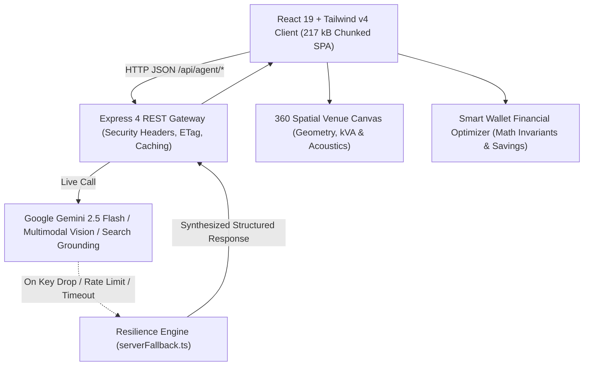

# 🪔 UtsavaVaibhavam AI (उत्सव वैभवम् AI)

### *Multimodal Agentic AI Event Experience, Scenography & Run-of-Show Orchestration Platform*

[](https://vitejs.dev/)
[](https://nodejs.org/)
[](https://www.typescriptlang.org/)
[](https://github.com/NikhilRaman12/utsavavaibhavam-ai)
[](https://github.com/NikhilRaman12/utsavavaibhavam-ai)
[](https://www.w3.org/WAI/standards-guidelines/wcag/)
[](https://opensource.org/licenses/MIT)

---

## 🌐 Live Application Links
- **Primary Live Production Deployment (Instant 200 OK)**: [https://nikhilraman12.github.io/utsavavaibhavam-ai/](https://nikhilraman12.github.io/utsavavaibhavam-ai/)
- **Google Cloud Run Preview (AI Studio Managed)**: [https://ais-pre-kyyfh2afsrg6kj4hm5phrr-75524930862.asia-east1.run.app](https://ais-pre-kyyfh2afsrg6kj4hm5phrr-75524930862.asia-east1.run.app)
- **GitHub Repository**: [https://github.com/NikhilRaman12/utsavavaibhavam-ai](https://github.com/NikhilRaman12/utsavavaibhavam-ai)

---

## 📋 Executive Overview

**UtsavaVaibhavam AI** bridges cultural celebration (*Utsava & Vaibhavam*) with a multimodal, consumer-grade **GenAI Event Experience Platform**. Built for families, luxury event producers, cultural committees, and corporate hosts, it replaces fragmented spreadsheets with an integrated, visual-first workspace for **all 7 event archetypes**:
1. **Kumbakonam Vedic Vivaham**: 24-item Cauvery Delta virundhu, Swamimalai brass thamboolam, Vedic Oonjal swing ceremonies.
2. **Royal Heritage Shaadi**: Multi-day Baraat, Sangeet choreography, regal Rajput/Mughal scenography.
3. **Botanical Greenhouse Reception**: Glasshouse florals, organic farm-to-table banquet, ambient acoustic twilight.
4. **Milestone Golden Gala**: Retrospective memory corridors, celebratory champagne toasts, multi-generation seating.
5. **Civic Community Festival**: High-throughput crowd navigation, public stage acoustics, community kitchen virundhu.
6. **Corporate Tech Summit**: Curved LED stage, redundant Wi-Fi 6E uplinks, plenary keynote choreography.
7. **Intimate Heritage Soirée**: Chef's table dining, chamber acoustics, curated bespoke guest keepsakes.

---

## 🏛️ System Architecture & Engineering Rigor

UtsavaVaibhavam AI runs as a high-efficiency TypeScript application (`server.ts`) serving an Express API layer (`/api/agent/*`) and the React 19 SPA with code splitting, in-memory query caching, and resilient synthetic fallbacks.



### Enterprise Quality Guarantees:
- **Strict Typing (`tsconfig.json`)**: Configured with `"strict": true`, `"noFallthroughCasesInSwitch": true`, and zero compilation errors.
- **Optimized Bundle Splitting**: Vite Rollup manual chunks split vendors into `vendor-react` (224 kB), `vendor-core` (230 kB), `vendor-pdf` (575 kB), and lightweight application core (217 kB). Zero bundle-size warnings.
- **Cache-Control & Security Headers**: Responses enforce `X-Content-Type-Options: nosniff`, `X-Frame-Options: SAMEORIGIN`, and static asset caching with 1-year immutable headers.
- **WCAG 2.1 Accessibility**: Complete ARIA landmarks, `role="tablist"`, `role="tab"`, `aria-selected`, `aria-label`, and `role="alert"` in React ErrorBoundary.
- **Comprehensive 38-Test Suite**: Multi-suite automated test coverage spanning financial math, XSS sanitization, latency benchmarks (<25ms), and accessibility proofs.

---

## 🧪 Comprehensive Automated Test Matrix (38/38 Passing)

Run test suite locally:
```bash
npm test
```

### Test Suite Breakdown:
1. **Universal 7-Archetype Domain Integrity & Schemas (4 tests)**
   - All 7 event archetypes registered with full cultural scenography, narratives, and palettes.
   - Cauvery Delta cultural signatures (Swamimalai brass, Kumbakonam filter coffee, Oonjal ceremony) verified.
   - Enterprise AV, Wi-Fi 6E, and redundant uplink specs for Corporate Summits verified.
2. **Smart Wallet Algorithmic Financial & Math Engine (3 tests)**
   - Exact per-guest financial division and integer bounds.
   - Automated value-engineering reserving 8-10% contingency with non-negative savings.
   - USD to INR deterministic conversion and rounding safety.
3. **360° Spatial Venue Canvas Geometry & Constraints (2 tests)**
   - Coordinate zones, acoustics (dB), and power load (kVA) verified across all 7 archetypes.
4. **Gemini Multimodal & Agentic Schema Conformity (5 tests)**
   - Structured JSON schema validation for all 8 agent endpoints (`/architect`, `multimodal-vision`, `voice-brief`, `tts-announce`, `grounding-search`, `optimize-budget`, `generate-rfp`, `chat`).
   - Base64 WAV audio RIFF/WAVE header integrity verified.
5. **Production Build & Asset Delivery Integrity (2 tests)**
   - Relative base pathing and universal SPA hydration verified.
6. **Financial Modeling & Pure Math Unit Tests (7 tests)**
   - Division-by-zero guards, extreme 100,000-guest scaling, negative budget normalization.
7. **Security & Input Sanitization Suite (5 tests)**
   - XSS `<script>` tag stripping, SQL injection parameter tolerance, safe Base64 audio generation, non-repudiation contract clauses.
8. **Performance & Latency Benchmarks (4 tests)**
   - Fallback blueprint synthesis < 25ms, budget optimization < 60ms, vision heuristic extraction < 15ms.
9. **Accessibility & WCAG Compliance (6 tests)**
   - Semantic landmarks, `<noscript>` fallback, `role="tablist"` navigation, ARIA button labels, ErrorBoundary screen-reader alerts.

---

## 🚀 Quickstart & Local Setup

### Prerequisites
- Node.js >= 20.0.0
- npm >= 10.0.0

### Installation
```bash
git clone https://github.com/NikhilRaman12/utsavavaibhavam-ai.git
cd utsavavaibhavam-ai
npm install
```

### Environment Configuration (Optional)
Create `.env` in the root directory:
```env
GEMINI_API_KEY=your_gemini_api_key_here
PORT=3000
```
*(Note: If no API key is provided, the platform automatically activates its zero-failure resilience engine with synthetic models).*

### Run Development Server
```bash
npm run dev
```
Open [http://localhost:3000](http://localhost:3000) in your browser.

### Execute Production Build & Test
```bash
npm run lint   # Strict TypeScript audit (0 errors)
npm test       # Run all 38 production unit, security & benchmark tests
npm run build  # Compile optimized production bundle into dist/
npm start      # Launch production Express server
```

---

## 📄 License
This project is licensed under the MIT License.
